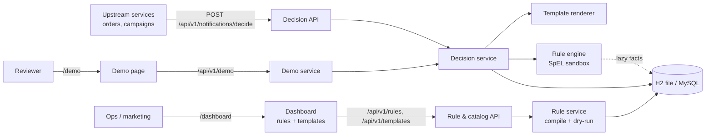

# HLD — Push Notification Decision Engine

An upstream service asks: *"may I send template X to user Y?"*. The engine runs the rules and answers ALLOWED or BLOCKED. On ALLOWED it returns the **rendered message** (`Hi {{user_name}}` → `Hi Aryant`) for the caller to deliver, and records it as sent.

## Requirements

| # | Requirement | Where enforced |
|---|---|---|
| R1 | Max 3 marketing pushes per user per day (user's local day) | Rule `DAILY_MARKETING_CAP` |
| R2 | No marketing push 22:00–08:00 in the user's timezone | Rule `QUIET_HOURS` |
| R3 | No duplicate campaign within 24h (configurable) | Rule `DUPLICATE_CAMPAIGN_24H`; the window is edited from the dashboard |
| R4 | Transactional messages always pass | **Code**, before rules. No dashboard edit can break it |
| R5 | New rules addable at runtime, no deploy | Rules in DB as sandboxed SpEL, managed via `/dashboard` |
| R6 | Templates with dynamic variables (`{{user_name}}`, `{{order_id}}`) | `TemplateRenderer`. A missing variable → 400 |
| R7 | Keep a record of every notification sent | `notifications` table (rendered title/body per send) |
| R8 | Zero-setup clone & run, plug into prod | H2 file DB (MySQL mode) + Flyway; `mysql` profile for prod; log file `logs/pronto.log` |

## Architecture



## Decision flow

```mermaid
sequenceDiagram
  participant C as Caller
  participant D as DecisionService
  participant T as TemplateRenderer
  participant E as RuleEngine
  participant DB as DB
  C->>D: decide(userId, templateCode, variables, idempotencyKey)
  D->>DB: SELECT user FOR UPDATE (per-user lock)
  D->>DB: idempotencyKey seen? return stored decision + message
  D->>T: render(template, user, variables)
  T-->>D: message, or 400 MISSING_TEMPLATE_VARIABLE
  alt TRANSACTIONAL
    D->>D: ALLOWED (TRANSACTIONAL_BYPASS)
  else MARKETING
    D->>E: evaluate(enabled rules by priority, facts)
    E->>DB: sent-today / last-campaign counts, only if a rule reads them
    E-->>D: first match wins; none = ALLOWED; error = BLOCKED
  end
  D->>DB: INSERT notification_decisions (audit + trace)
  opt ALLOWED
    D->>DB: INSERT notifications (rendered message)
  end
  D-->>C: decision, reason, trace, message (if ALLOWED)
```

## Key decisions

| Decision | Why |
|---|---|
| **SpEL + `SimpleEvaluationContext`**, not MVEL | Dashboard rules are untrusted input. MVEL can call any Java class (RCE). SimpleEvaluationContext blocks `T()`, `new`, bean refs and `getClass()`. Ships with Spring. |
| Caller picks the template; rules only gate | Predictable. The order service knows it is sending ORDER_SHIPPED. Event-driven template selection is a later feature. |
| Render **before** rules, strict on missing vars | A caller bug fails fast with 400, before any rule or cap is touched. |
| Two tables: `notification_decisions` (every attempt) + `notifications` (only sent) | Audit/debug every attempt with its rule trace. Caps and dedupe count only what was really sent. The sent table holds the exact rendered text the user saw. |
| Transactional bypass in code | R4 is an invariant, not a rule. |
| First match wins, priority ascending, default ALLOW, **fail-closed** on rule error | Explainable (trace stored), whitelists possible (ALLOW rules), a broken rule can't cause spam. |
| Per-user row lock in the decide transaction | Stops 2 parallel requests both seeing "2 sent" and both passing. Works across instances. |
| Idempotency key | A caller retry returns the stored decision; it never consumes a second cap slot. |
| Rules read per request, compiled expression cached by `(id, version)` | Tiny table. Multi-instance safe with no cache invalidation. |
| Flyway + `ddl-auto: validate`; rolling log file | Same schema on H2 and MySQL; logs survive restarts and can be shipped. |

## Scaling path (not built — add when needed)

- Cap/dedupe counters → Redis `INCR`/`EXPIRE` once index scans on `notifications` become the bottleneck.
- `notification_decisions` → monthly partitions / an archive once it gets large.
- Dashboard auth → keep it behind SSO/ingress for now; add Spring Security once it is exposed.
- Event-driven template selection, delivery adapter (FCM) + delivery status, per-user rule overrides → when a real consumer asks.
