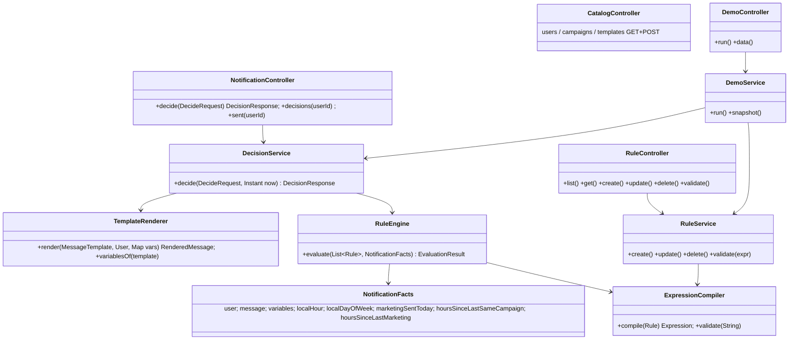

# LLD

Package root `org.pronto.pronto`. Classic MVC layering: `controller → service → repository → entity`. Coding rules: [CODING_GUIDELINES.md](CODING_GUIDELINES.md).

## Packages

| Package | Classes |
|---|---|
| `entity` | `User`, `Campaign`, `MessageTemplate`, `Rule`, `NotificationDecision`, `Notification`; enums `MessageType {TRANSACTIONAL, MARKETING}`, `RuleAction {BLOCK, ALLOW}`, `Decision {ALLOWED, BLOCKED}` |
| `repository` | one Spring Data repo per entity. `UserRepository.findByIdForUpdate` (`@Lock(PESSIMISTIC_WRITE)`). Cap/dedupe queries on `NotificationRepository` |
| `engine` | `ExpressionCompiler`, `NotificationFacts` (+ `UserFacts`, `MessageFacts`), `RuleEngine`, `EvaluationResult`, `RuleTrace` |
| `template` | `TemplateRenderer`, `RenderedMessage` |
| `service` | `DecisionService`, `RuleService`, `CatalogService`, `DemoService`, existing `HealthService` |
| `controller` | `NotificationController`, `RuleController`, `CatalogController`, `DemoController`, existing `HealthController` |
| `dto` | request/response objects (`@Value @Builder`); entities never leave the service layer |
| `exception` | `NotFoundException`, `ConflictException`, `InvalidRuleException`, `MissingTemplateVariableException`, `GlobalExceptionHandler` |
| `config` | `ClockConfig` (`Clock` bean, UTC), `WebConfig` (static page routes), `RequestIdFilter` (MDC `requestId` in every log line) |

## Template rendering

- Syntax `{{name}}`; `name` matches `[A-Za-z0-9_]+`; spaces inside braces are allowed (`{{ user_name }}`). One regex (`\{\{\s*([A-Za-z0-9_]+)\s*\}\}`) plus `Matcher.replaceAll`. No template library.
- Variable sources, in precedence order:
  1. system: `user_name`, `user_city`, `user_id` (from the DB, so they can't be spoofed)
  2. the request's `variables` map (values via `String.valueOf`)
- Title, body and deep link are all rendered.
- Any placeholder with no value → `MissingTemplateVariableException` → 400 `{code: "MISSING_TEMPLATE_VARIABLE", missing: ["order_id"]}`. This happens before rule evaluation. Nothing is stored.
- Rendered output is plain text (push payload). Pages that display it must use `textContent`, never `innerHTML`.
- `GET /api/v1/templates` returns `requiredVariables` per template (parsed with the same regex), so callers know what to send.

## Expression sandbox (security-critical)

- `SimpleEvaluationContext.forReadOnlyDataBinding().withInstanceMethods().withRootObject(facts)`. **Never** `StandardEvaluationContext`.
- It blocks `T(...)`, `new`, `@bean`, assignment. `DataBindingMethodResolver` refuses `Object`/`Class`/`ClassLoader` methods, so `getClass()` is blocked. Allowed: `{1,2}.contains(user.hubId)`, `user.city.startsWith('BLR')`.
- Root = `NotificationFacts`. Only plain values and fact getters. No JPA entities or repositories are reachable.
- Max expression length 1000. `validate(expr)` parses it, then evaluates it against stub facts (no DB, empty `variables`). The result must be `Boolean`, otherwise → 400 with the SpEL message.
- Optional variables must be null-guarded. This forces rule authors to handle a missing variable:
  - SpEL treats `null < 199` as **true**, so write `variables['cartValue'] != null and variables['cartValue'] < 199`
  - `variables['tier'] == 'GOLD'` is null-safe; `variables['name']?.length()` uses safe navigation
  - an unguarded `variables['name'].length()` fails the dry-run → 400

## Facts available to rule expressions

| Expression | Type | Meaning |
|---|---|---|
| `user.id`, `user.name`, `user.timezone`, `user.city`, `user.hubId`, `user.orderCount` | long/String/int | user profile |
| `message.type`, `message.templateCode`, `message.campaignCode` | String (campaignCode nullable) | message being decided |
| `variables['key']` | Map<String,Object> | the request's variables, e.g. `variables['cartValue'] < 199` |
| `localHour` | int 0–23 | hour in the user's timezone at `now` |
| `localDayOfWeek` | String | `MONDAY`…`SUNDAY` |
| `marketingSentToday` | long | MARKETING rows in `notifications` since the user's local midnight. **Lazy**: queried only if a rule reads it |
| `hoursSinceLastSameCampaign` | double | hours since the last sent notification of this campaign; `1e9` if none or no campaign. Lazy |
| `hoursSinceLastMarketing` | double | hours since the last sent MARKETING notification; `1e9` if none. Lazy |

Lazy facts are memoized per evaluation. Every query is bounded by `sent_at <= now`.

## DecisionService.decide(req, now) — `@Transactional`

Orchestrator only. Each step is a private method of 60 lines or fewer.

1. `lockUser`: `findByIdForUpdate`; missing → 404.
2. `findReplay`: if `idempotencyKey` exists → return the stored decision + its notification. This runs after the lock, so it is race-free.
3. `loadTemplate` by code; missing → 404.
4. `TemplateRenderer.render` (400 on a missing variable).
5. `TRANSACTIONAL` → ALLOWED `TRANSACTIONAL_BYPASS`. Otherwise `RuleEngine.evaluate(enabled rules ORDER BY priority, id)`:
   - the first `true` decides (`BLOCK`→BLOCKED, `ALLOW`→ALLOWED)
   - an exception → BLOCKED `RULE_ERROR: <name>: <msg>` (fail-closed)
   - no match → ALLOWED `DEFAULT_ALLOW`
6. `persist`: insert into `notification_decisions` (variables + trace as JSON). If ALLOWED, also insert into `notifications` with the rendered message, `sent_at = now`.
7. Log `decision userId={} template={} result={} rule={} decisionId={} notificationId={}`.

`now` = `Clock` in the API path; demo and tests pass explicit instants.

## API

| Method | Path | Notes |
|---|---|---|
| POST | `/api/v1/notifications/decide` | `{userId, templateCode, idempotencyKey?, variables?}` → 200 `{decisionId, decision, reason, ruleId, ruleName, messageType, decidedAt, notificationId, message{title,body,deepLink}, trace[]}`. BLOCKED is still 200, with `message` = null |
| GET | `/api/v1/notifications/decisions?userId=&limit=50` | audit log, latest first |
| GET | `/api/v1/notifications/sent?userId=&limit=50` | sent notifications, latest first |
| GET/POST | `/api/v1/rules` | list (priority order) / create |
| GET/PUT/DELETE | `/api/v1/rules/{id}` | DELETE on a system rule → 409; PUT with a stale `version` → 409 |
| POST | `/api/v1/rules/validate` | `{expression}` → `{valid, error?}` |
| GET/POST | `/api/v1/users`, `/api/v1/campaigns`, `/api/v1/templates` | catalog setup |
| POST | `/api/v1/demo/run` | runs the scripted scenario |
| GET | `/api/v1/demo/data` | all tables (decisions/notifications: last 100) |
| GET | `/health` | existing |

Errors → `{code, message, details?}`. 400 bad input / invalid rule / missing variable, 404, 409.

## Pages (static HTML + vanilla JS in `src/main/resources/static`)

| URL | Purpose |
|---|---|
| `/dashboard` | rules table: priority, name, expression, action, enabled toggle, edit, delete (not for system rules) |
| `/dashboard/new` | rule form + facts cheat sheet + **Validate** button; `?id=N` = edit |
| `/dashboard/templates` | template list (with required variables) + create form |
| `/demo` | **Run scenario** → numbered step log, then table dumps |

## Logging

- `@Slf4j` everywhere. Parameterized messages only (`log.info("rule created id={} name={}", ...)`).
- File `logs/pronto.log` (Spring Boot `logging.file.name`), rolling 10MB × 7 files, plus the console.
- Pattern includes `%X{requestId}`. `RequestIdFilter` takes `X-Request-Id` or generates one, and echoes it back in the response header.
- INFO: decisions, rule/template changes, demo steps. WARN: 4xx business rejections. ERROR: unexpected exceptions, with stack trace. DEBUG: per-rule evaluation.
- Log user **ids**, not names (PII).

## Demo scenario (`DemoService.run`)

Fresh user per run (`demo-<timestamp>`, Asia/Kolkata, city Bengaluru). `D` = the local date 2 days ago. Steps run in chronological order. Each step shows the simulated time, request, expected vs actual, deciding rule, rendered message, and the `decision_id`/`notification_id` rows created.

| # | Local time | Action | Expected |
|---|---|---|---|
| 1 | — | create demo user | user row id |
| 2 | D 03:00 | `ORDER_SHIPPED` {order_id, eta} | ALLOWED bypass despite quiet hours; message `Hi demo-…, your order is on the way` |
| 3 | D 03:05 | `ORDER_SHIPPED` without `order_id` | 400 `MISSING_TEMPLATE_VARIABLE`, no row |
| 4 | D 10:00 | `DIWALI_OFFER` {discount: 40%} | ALLOWED (1/3) |
| 5 | D 11:00 | `DIWALI_OFFER` | BLOCKED `DUPLICATE_CAMPAIGN_24H` |
| 6 | D 12:00 | `FLASH_SALE` {ends_at} | ALLOWED (2/3) |
| 7 | D 13:00 | `WEEKEND_DEALS` | ALLOWED (3/3) |
| 8 | D 14:00 | `NEW_ARRIVALS` | BLOCKED `DAILY_MARKETING_CAP` |
| 9 | D 15:00 | `ORDER_DELIVERED` {order_id} | ALLOWED, cap ignored |
| 10 | D 23:30 | `NEW_ARRIVALS` | BLOCKED `QUIET_HOURS` |
| 11 | — | create dynamic rule via `RuleService` (same path as the dashboard): `user.id == <id> and variables['cartValue'] != null and variables['cartValue'] < 199` BLOCK, priority 5 | rule row id |
| 12 | D+1 10:30 | `FLASH_SALE` {cartValue: 150} | BLOCKED by the dynamic rule |
| 13 | D+1 10:45 | `FLASH_SALE` {cartValue: 500} | BLOCKED `DUPLICATE_CAMPAIGN_24H` (22h45m since step 6) |
| 14 | D+1 11:00 | `DIWALI_OFFER` {cartValue: 500} | ALLOWED: 25h > 24h window, and the cap reset at local midnight |
| 15 | — | delete dynamic rule | cleanup logged |
